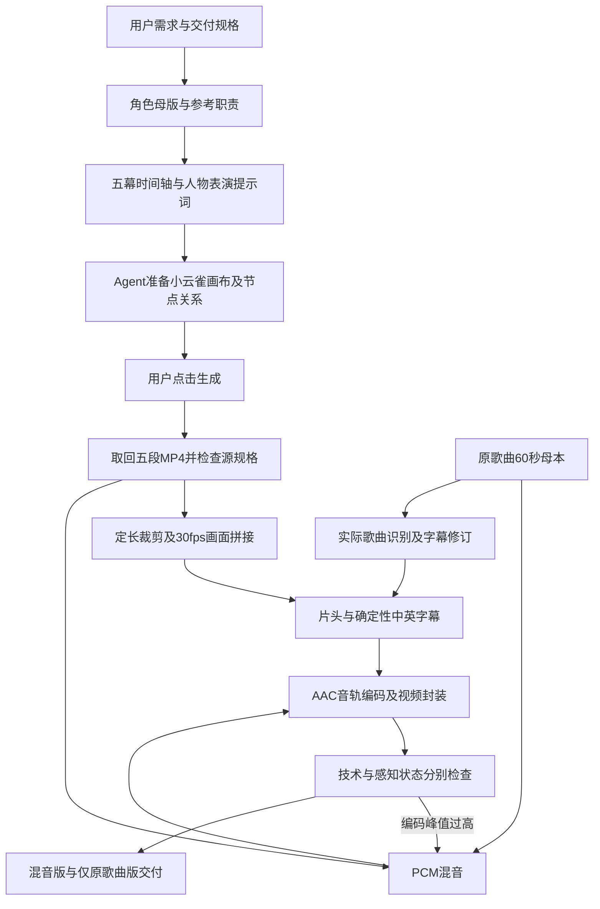

# PRD / 实作案例：贵妃醉酒｜The Drunken Beauty

日期：2026-10-11 · 角色MV · 目标60秒、720×1280、9:16、后期30fps

## 产品意图与用户验收

以一个可辨识的贵妃角色贯穿盛唐入梦、初现、舞蹈、盛极而衰与一梦千年的情绪过程。角色只来自Guifei_Master母版；6秒舞蹈参考只贡献动作和运镜。完成视频须有主歌曲、前0–4秒署名和确定性双语歌词，允许最新用户修改音轨策略。五幕原生成镜头不因后期包装重做。

## 输入资产与职责

| 资产 | 职责 | 不借用 |
|---|---|---|
| Guifei_Master.png | 唯一人物身份、妆发、红金唐装、首饰、脸与体态 | 不冻结所有动作 |
| 6秒 reference.MP4 | 舞蹈/动作节奏、运镜参考 | 参考演员脸、服装、手机界面、文字 |
| 原歌曲67–127秒的60秒片段 | 歌曲主音轨，拍点、唱词与字幕时间基准 | 不变速、不重唱 |
| 五幕生成MP4 | 画面母本；后来允许低量混入自带声音 | 不假称生成音轨来自原歌曲 |

输入照片、歌曲、参考舞者视频和成片保留在用户本地；本仓库只有流程、配置示例和脱敏技术证据。

## 逐幕生产计划

| 镜头 | 时间/帧 | 内容 | 时长 |
|---|---|---|---|
| 01 盛唐入梦 | 0–10s / 0–299 | 宫殿、灯笼、暖色空间与人物引入 | 10s |
| 02 贵妃初现 | 10–20s / 300–599 | 妆发首饰、眼神、轻转头与人物近景 | 10s |
| 03 霓裳醉舞 | 20–35s / 600–1049 | 真正转身和袖舞，沿用角色母版 | 15s |
| 04 盛极而衰 | 35–50s / 1050–1499 | 杯盏与情绪变化，暖光向夜色过渡 | 15s |
| 05 一梦千年 | 50–60s / 1500–1799 | 夜宫余韵、人物离开/消散、空景 | 10s |

片头叠在第一幕0–4秒，不增加黑场/单独片头时长。默认严格五个时间槽，不用未经预算的overlap缩短片长。

## 流程图

## 1. Brief与导演

从用户要求提取画幅、720P、Seedance2.5正式版、时长、母版、舞蹈参考职责、歌词与署名。人物skill负责可见动机、微表情、肩臂先导、重心和结束姿态；镜头skill检查景别、朝向与轴线。舞蹈提示词不把“动作相似”变成换演员。

每幕提示词：身份锚点 → 起始姿态与空间 → 连续事件 → 运镜/光 → 结束状态 → 音轨和字幕限制。分镜和状态由各幕实际首尾帧回写；不能只相信提示词预期结尾。

## 2. 小云雀画布准备

Agent读取已打开的画布并操作：上传母版/音乐/参考，建立节点，逐个填写提示词、模型、分辨率、画幅和时长。明确将角色图片接为身份参考，将6秒视频接为动作/运镜参考；检查连接方向、重复素材和目标第三幕节点。验证界面显示，不仅把引用写进文本。

模型名、价格、可选时長/画幅根据当时UI核实。用户授权范围是Agent准备、用户点击生成；Agent因此停在可检查的就绪状态，没有伪记自动调用Seedance。五段最终生成文件随后由用户提供。

## 3. 镜头导入与实际规格检查

实际五段是720×1280、H.264、yuv420p、24fps；前三种10秒槽的源文件为241帧/10.041667秒，两个15秒槽为361帧/15.041667秒；自带AAC为32kHz双声道。复制原件并留哈希，精确裁成10/10/15/15/10秒；30fps时间采样后拼接成1800帧。

CFR转换没有改变片段播放速度，不等于光流补帧；无需为了规格转换重新生成全部画面。源片缺少明确色彩标记，未猜测并强制色域变换。

## 4. 声音方案及用户变更

最初规格为仅原歌曲、丢弃全部生成音轨。先完成仅原歌曲clean master。用户随后表示“自带的歌曲和新贵妃醉酒弄一起也行”，最新音轨策略因此改为：原歌曲为主、自带声音低量混入。两个版本共享同一最终画面码流。

案例参数：主歌曲-1dB，生成音轨-24dB；生成各幕边缘0.2秒淡入淡出；PCM48kHz双声道合成、amix不自动归一化。没有声称独立分离了生成声中的人声，也未完成两首歌的调性/节拍重编排。

**真实故障与修复：** 第一版AAC解码峰值1.311，超过0dBFS，即使PCM总线有sample limiter仍可能编码过冲。整体增益再乘0.66；最终解码峰值约0.879（约-1.12dBFS）。这是本次测量后的参数，不是通用固定值。后期库按用户的峰值预算从PCM重新编码音轨，保留画面码流；不修改歌曲速度与时间位置。

实测源歌曲与混音零时差相关性约0.999982，混音与编码音轨约0.999614；它们证明同步/波形主导关系，不能证明“听起来协调”。本次音频输入工具无法试听，listening仍为not_verified。

## 5. 实际歌曲字幕

用用户提供的实际音频进行本地Whisper tiny/small/medium识别；唱腔导致多处地名、拖音和同音字误识别。另制降调分析副本交叉检查，原歌曲不改调不变速。根据这些证据做编辑修订和英文译文；保留词级结果、时间戳和低置信项目。

英文上、中文下，中文更大，留足底部安全区。产出中文、英文、双语SRT与双语ASS。当前FFmpeg9没有libass/subtitles滤镜，实作明确采用Pillow固定字体PNG字形 + FFmpeg时间条件overlay，未声称真正libass烧入。后期工具支持可用时ASS直烧，缺失时记录降级。

**没有完成的验收：** 不能把多模型ASR加编辑修订写成“逐字人工试听确认”。首句地名与部分副歌字词仍有复核风险。本仓库不再刊登整段歌曲歌词；通用配置须由制作时实际转录填写。

## 6. 包装与编码

片头0–4秒：贵妃醉酒 / The Drunken Beauty / 导演：剑桥学长 Simon / 制作：Seedance 2.5。金色中文衬线、英文衬线与小号署名；首尾短淡入淡出，字幕用浅色描边确保明暗画面可读。

最终H.264/yuv420p，720×1280，30/1，1800帧，视频/音频/容器均60.000秒；AAC48kHz双声道；faststart。本次约28MiB。两个音轨版本用stream-copy相同画面，不增加画面重编码。

## 7. QA证据与交付

- ffprobe尺寸/fps/帧数/时长/音频通过；全片FFmpeg解码日志为空。
- 2/8/16/22/28/33/39/46/51/57秒抽帧：署名、双语位置、安全区、五幕身份与光线变化可视检查。
- AAC解码峰值重测；歌曲与混音同步相关性记录。
- 两版本视频H.264码流SHA相同。
- 未假称完整动态身份、生成模型来源或感知混音已全部人工验收；Seedance2.5来自用户生成时的选择与说明。
- 交付混音版MP4、仅原歌曲版、editable ASS/SRT、接触表、命令/规格/哈希manifest及后期说明。

脱敏技术证据见 [recorded-qa.json](../examples/guifei/recorded-qa.json)。它是历史实测摘要，不是重新跑了Seedance的报告。通用输入示例见 [production.json](../examples/guifei/production.json)，先替换素材路径、字体并填入字幕，再运行后期脚本。

## 8. 可复用产品经验

角色母版与动作参考分别赋权；生成提交责任明确；固定时长以整数帧落地；歌词/署名属于确定性后期；自带音轨策略响应用户最新选择；PCM sample peak不能代替编码后峰值检查；技术PASS不能冒充试听PASS。HyperFrames和Remotion适合包装/导演母版，FFmpeg适合这次已有五段素材的拼接；没有为凑工具名单重做已认可画面。
